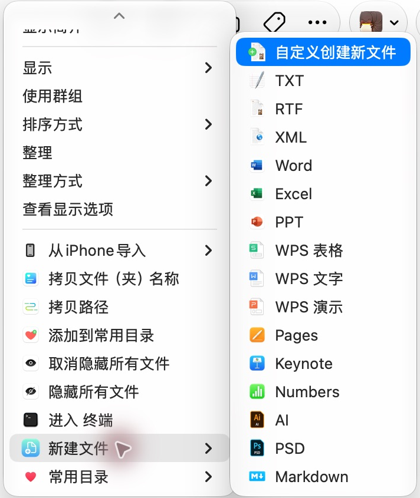
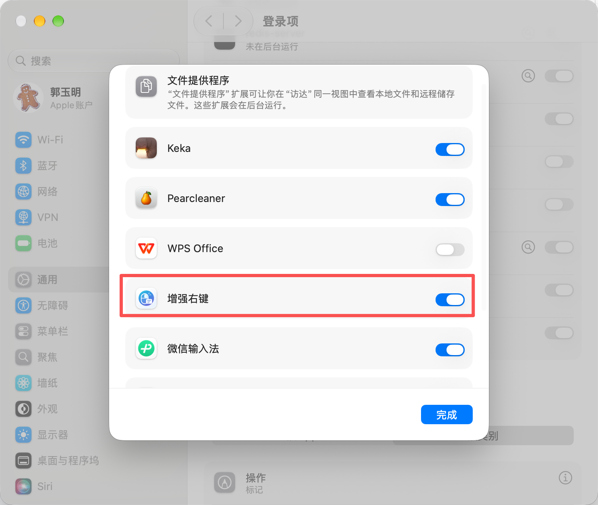

<div align="center">
  
  <h1>SuperMenu for macOS · 增强右键</h1>
  <p>A native macOS Finder extension for creating files, converting images, and everyday file actions.</p>
  <p><strong>Free and open source · No subscription · Native macOS interface</strong></p>
  <p><a href="README.md">简体中文</a> · <strong>English</strong></p>
  <p><a href="https://github.com/1078302479/SuperMenu/releases/latest">Download for macOS</a> · <a href="#screenshots">Screenshots</a> · <a href="#first-time-setup">Setup guide</a> · <a href="#build-from-source">Build from source</a></p>
</div>

**Latest stable release: [v0.5.0](https://github.com/1078302479/SuperMenu/releases/tag/v0.5.0)**, with cloud-folder menu triggers, in-app update downloads, and redesigned General settings. See the [changelog (Chinese)](CHANGELOG.md).

**Upcoming: v0.5.1 (release candidate)** — fixes Finder action dispatch and image conversion targets, refreshes General settings, and adds a mandatory release preflight. Not published yet; download links below still point to v0.5.0.

## About

SuperMenu (增强右键) adds file creation, file transfers, image conversion, favorite folders, and other actions to Finder's context menu. It is built with Swift, AppKit, and SwiftUI. Menu names and order can be customized in the settings app.

This free, independent open-source project aims to cover the features of iRightMouse PRO. Feature parity is still in progress; see [Known limitations](#known-limitations). It is not affiliated with the reference product.

## Download and install

| Requirement | Details |
| --- | --- |
| macOS | 13 or later |
| Download architecture | Apple silicon (arm64) |
| Latest release | [v0.5.0](https://github.com/1078302479/SuperMenu/releases/latest) |
| Downloads | [DMG installer](https://github.com/1078302479/SuperMenu/releases/download/v0.5.0/SuperMenu-v0.5.0-arm64.dmg), [app ZIP](https://github.com/1078302479/SuperMenu/releases/download/v0.5.0/SuperMenu-v0.5.0-arm64.zip), source ZIP, and SHA256 checksums |

Open the DMG, drag 增强右键 into Applications, and launch it from there. Enable its Finder extension as described below.

The app is ad-hoc signed and has not been notarized by Apple. If macOS blocks the first launch, consult [Apple's instructions for opening apps](https://support.apple.com/en-us/102445).

## Screenshots

### General settings · v0.5.1 candidate

Actual installed-app screenshots, not design mockups. General fits the default window with a fixed bottom check bar. Permission colors reflect the captured machine: green means ready, orange needs attention, gray is unknown. Ad hoc updates may require reauthorization.


### Templates and toolbox · v0.5.1 candidate


### Finder context menu

Actual **v0.4.1** screenshot, cropped to the context menu. The New File submenu lists all 15 built-in formats. Menu contents and order depend on your settings and selection; long menus can be scrolled.

<p align="center">
  
</p>

## Features

| Category | Available actions |
| --- | --- |
| Create files | TXT, RTF, XML, Markdown, Word, Excel, PowerPoint, WPS Writer/Spreadsheets/Presentation, Pages, Numbers, Keynote, AI, and PSD. Custom filenames and imported templates are supported. |
| Transfer files | Cut and paste, copy or move to saved folders, recent targets, or a custom location, with conflict handling and cross-volume copy verification. |
| Favorite folders | Add, rename, reorder, and open favorite locations. |
| File and folder icons | Import, apply, and restore icons from the settings app. |
| File tools | Copy names and paths, create folders using filenames, checksums, visibility and extension flags, desktop aliases, AirDrop, folder dissolution, permanent deletion, and ZIP/7z archives. |
| Images and apps | Convert PNG, JPG, WebP, HEIC, and ICNS; export macOS, iPhone, iPad, and Apple Watch icon groups; set wallpaper; open a location in Terminal, iTerm2, or a custom app. |
| Text services | Translation and QR-code generation with automatic clipboard copying. |

All 15 built-in document formats are bundled. An appropriate editor is needed to open formats such as WPS, iWork, AI, and PSD; installing that editor is not required to enable the format in settings.

## First-time setup

**1. Open the extension settings from the app**

Launch 增强右键, select General Settings (通用设置), and click the Finder extension status button (访达扩展) under Permissions and access. A startup prompt may also offer a shortcut to System Settings.


**2. Enable the extension in System Settings**

Find 增强右键, turn on its switch, and click Done. The supplied screenshot labels this panel File Providers (文件提供程序). Names and locations vary by macOS version; use the in-app button to navigate there.



**3. Confirm the status**

Return to the app and click Check again (重新检查). The Finder extension should show Enabled (已启用) in green, as shown in the General screenshot. Status refreshes every 30 seconds while the app runs and when you return to the app.

Protected Directory Access is a separate check. Restricted access does not mean the Finder extension is disabled or that all ordinary folders are unavailable. If an operation fails in a protected location, use Open Full Disk Access Settings and enable the installed app, then follow macOS restart instructions. This status is an access probe, not an exact reading of the Full Disk Access toggle. An unknown result does not mean permission has been granted.

## Everyday use

- **Create a file:** right-click an empty area in a Finder folder and choose New File. Enable formats in the New File settings page.
- **Customize menus:** double-click a display name to edit it and drag to reorder. Promote a document format to the main context menu using its Main Menu checkbox.
- **Copy or move:** select files and choose Copy Files To or Move Files To. Configure destinations in Send Files To.
- **Cut and paste:** cut selected files, then right-click an empty area in the destination folder to paste. Cancel Cut clears a pending operation.
- **Convert images:** select images and choose a conversion format. Output is saved beside the originals without a success dialog. Original files are preserved and collisions receive numbered names.
- **Change icons:** choose an icon in the File/Folder Icons settings page and use Apply Selected Icon. Use Restore Original Icon to revert it.
- **Choose tools:** enable the actions you want in Toolbox. Context menus show applicable actions for files, folders, images, or empty areas.

The menu bar icon has Preferences and Quit entries. A New File toolbar entry can also be added through Finder's View → Customize Toolbar.

## Updates and troubleshooting

- **Updates:** General Settings offers Check for Updates and an automatic-check toggle. After a successful automatic check, at least 24 hours must pass before another one. Updates can be downloaded and verified in the app, with progress and cancellation. Installation requires confirmation; manual GitHub downloads remain available.
- **Upgrade:** quit the old app, replace it in Applications, launch the new one, and check the extension status. Normal replacement preserves configuration.
- **Missing menus:** verify extension status, disk scope, and the corresponding enabled actions. If necessary, turn the extension off and on in System Settings and reopen the context menu.
- **Duplicate menus:** similar extensions can each add their own entries. Keep only the extensions you want enabled.
- **Missing templates in an older version:** upgrade to v0.4.1 or later, which bundles every built-in format.

Installed-app configuration is stored in `~/Library/Application Support/io.github.1078302479.SuperMenu`.

## Known limitations

Modifier-key and middle-click cloud-folder triggers require Accessibility and Finder Automation permissions. Three-finger triggers remain unavailable. OneDrive, multiple windows, login scenarios and the complete update replacement/restart flow require further hands-on validation. Ad hoc signed upgrades may require removing and re-adding Accessibility permission; follow the guide in General settings. iShot, FastZip, and DiskMap currently have app-opening entries; deeper task integration remains unfinished. Password-protected archives and some special archive entries are unsupported. Further real-device compatibility testing is needed across Finder, system services, login items, and third-party apps. Download cloud files locally before processing them.

## Build from source

Requires macOS 13 or later and Apple Command Line Tools. The build targets the current Mac's architecture.

```sh
SUPERMENU_INCLUDE_REFERENCE_ASSETS=0 ./scripts/build-local.sh
open ".build/local/增强右键.app"
```

Enable the Finder extension using the setup guide above. Local builds are ad-hoc signed and store settings in `.build/local/shared`; installed distribution builds use the user configuration directory shown above.

## Development and tests

```sh
SUPERMENU_INCLUDE_REFERENCE_ASSETS=0 ./scripts/test-background.sh
```

Background tests cover file operations, conflict handling, template compatibility, settings, menu icon payloads, and Finder request handoff. Tests use temporary app identities and isolated storage.

Builds and tests share `.build/module-cache`. Preview cleanup before applying it:

```sh
python3 scripts/clean-builds.py
python3 scripts/clean-builds.py --apply
```

Cleanup retains source, resources, the latest local/review apps, local user settings, dependencies, and the shared compiler cache. It removes older review builds, historical release outputs, and reproducible test artifacts.

## License and resource sources

Original project code and resources use the [Apache License 2.0](LICENSE). [libwebp](ThirdParty/README.md) retains its own license. Third-party reference icons and seed documents are not covered by the project’s Apache-2.0 license; see [icon sources](Resources/ReferenceIcons/来源说明.md) and [template sources](Resources/Templates/来源说明.md).

Copyright © 2026 1078302479. See [Contributing](CONTRIBUTING.md) for development and contribution guidelines. This change applies to original content licensed under Apache-2.0 in the current repository and future revisions. Existing v0.4.1 and earlier release packages retain their included licenses.
