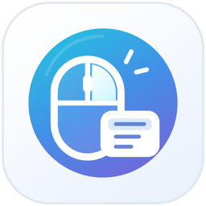
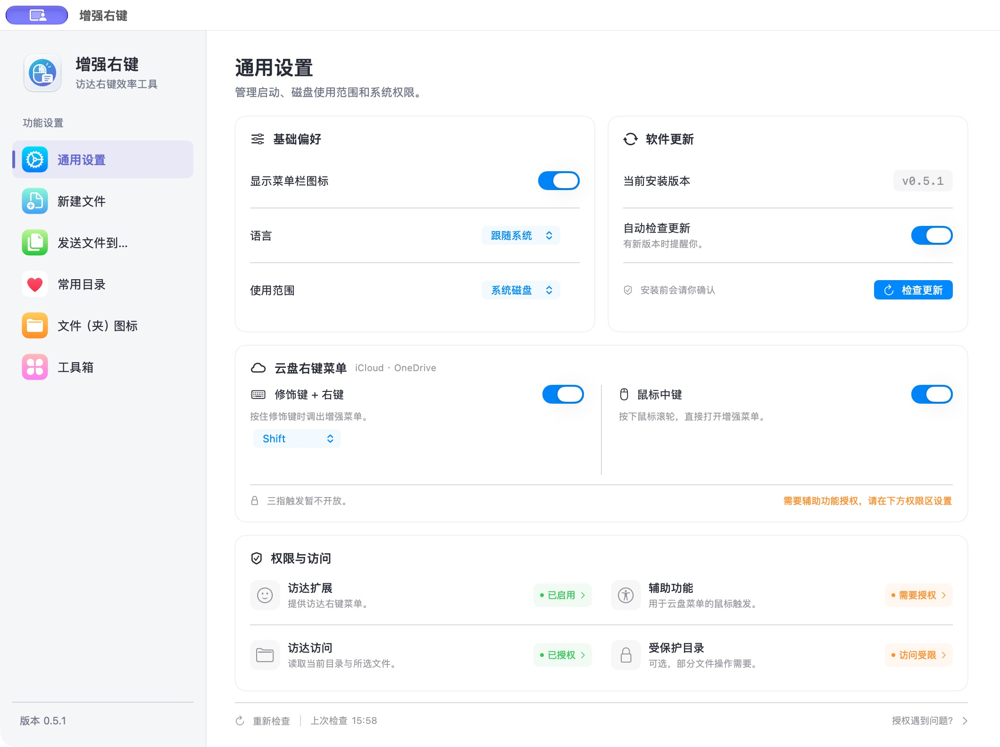
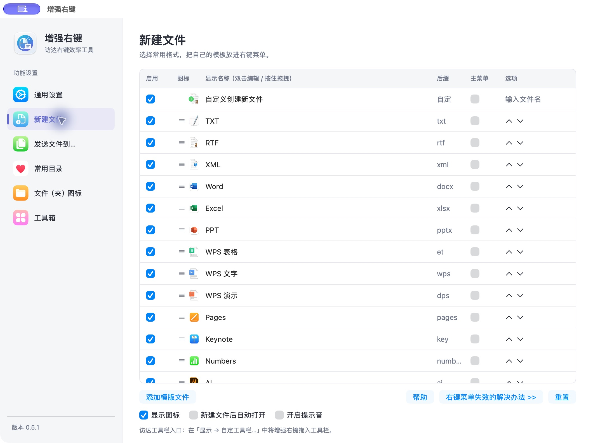
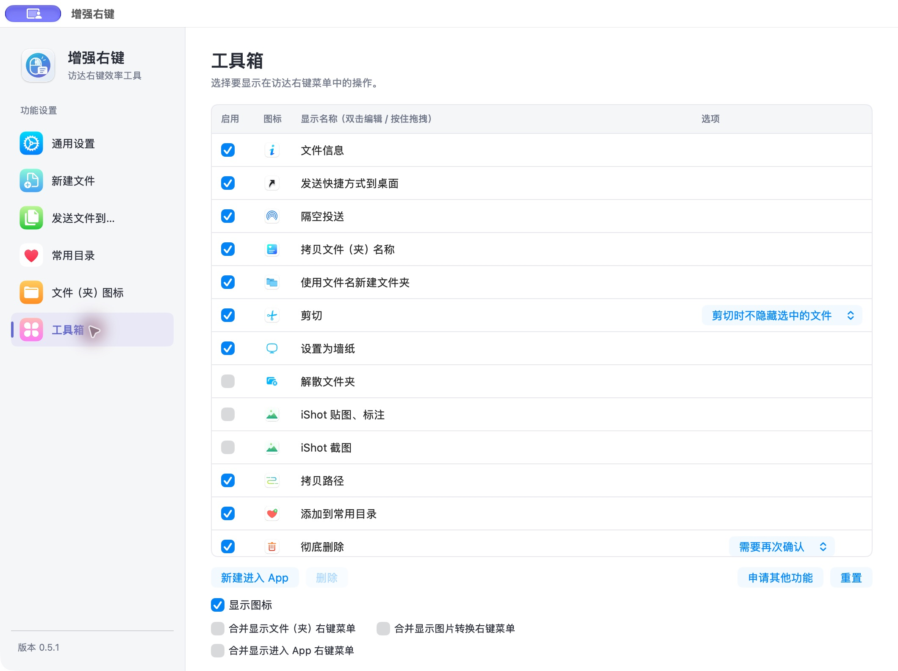
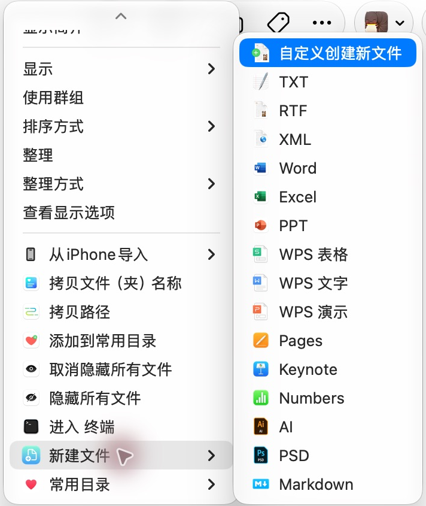
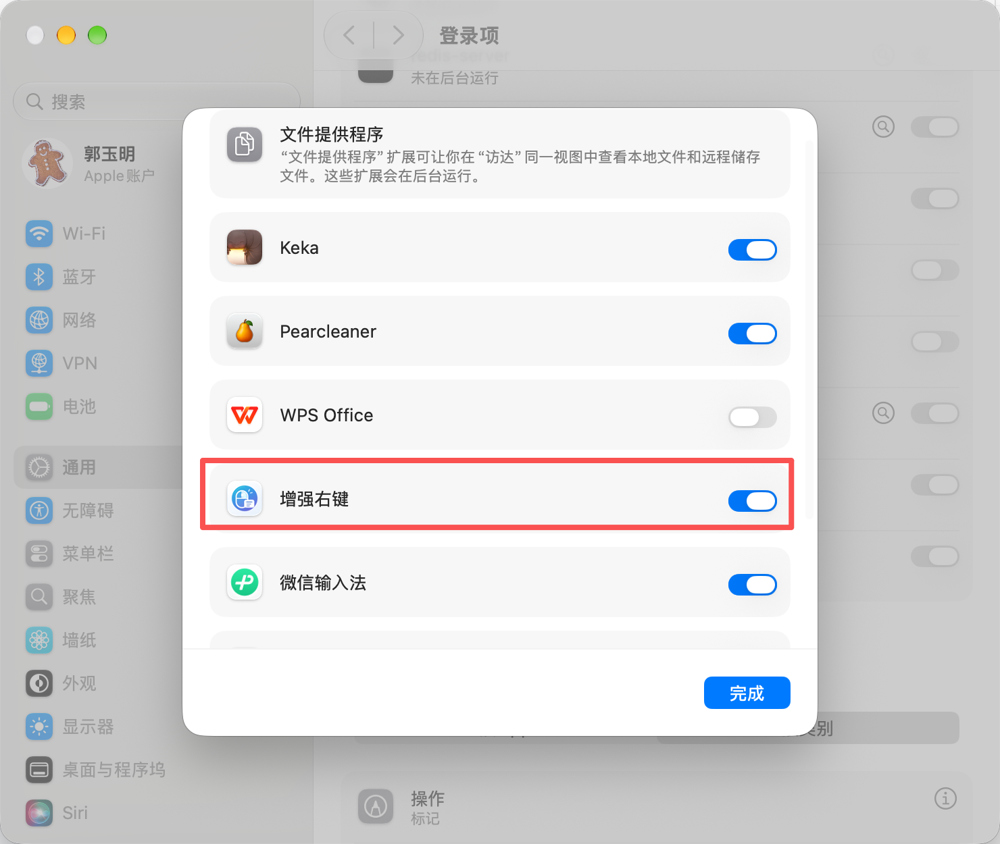

<div align="center">
  
  <h1>增强右键 for macOS</h1>
  <p>把新建文件、图片转换和常用操作，放进访达右键菜单。</p>
  <p>A native macOS Finder extension for creating files, converting images, and everyday file actions.</p>
  <p><strong>免费开源 · 无需订阅 · 原生 macOS 体验</strong></p>
  <p><strong>简体中文</strong> · <a href="README.en.md">English</a></p>
  <p><a href="https://github.com/1078302479/SuperMenu/releases/latest">macOS 下载页</a> · <a href="#界面预览">界面截图</a> · <a href="#首次使用">使用说明</a> · <a href="#从源码构建">从源码构建</a></p>
</div>

**最新正式版：[v0.5.0](https://github.com/1078302479/SuperMenu/releases/tag/v0.5.0)**，新增云盘菜单触发、应用内下载升级与通用设置重设计。修复内容见 [更新记录](CHANGELOG.md)。

**准备发布：v0.5.1（候选版）**，修复访达菜单动作与图片转换目标，重新设计通用设置，并加入强制发布前检查。尚未正式发布，下方下载链接仍指向 v0.5.0。

## 简介

增强右键是一款使用 Swift、AppKit 和 SwiftUI 开发的 macOS 访达右键增强工具。你可以在文件夹中直接新建文件，将文件复制或移动到常用位置，转换图片格式，并按自己的习惯调整菜单名称和顺序。

项目免费开源，无需订阅，以覆盖[超级右键 PRO](https://aodo365.com/irightmousepro.html)的全部功能为目标。目前仍有未完成项目，见[已知限制](#已知限制)。这是独立开源项目，与参考产品没有隶属关系。

## 下载与安装

| 项目 | 说明 |
| --- | --- |
| 系统要求 | macOS 13 或更高版本 |
| 安装包架构 | Apple 芯片（arm64） |
| 最新版本 | [v0.5.0 正式版](https://github.com/1078302479/SuperMenu/releases/latest) |
| 下载格式 | [DMG 安装包](https://github.com/1078302479/SuperMenu/releases/download/v0.5.0/SuperMenu-v0.5.0-arm64.dmg)、[应用 ZIP](https://github.com/1078302479/SuperMenu/releases/download/v0.5.0/SuperMenu-v0.5.0-arm64.zip)、源码及 SHA256 校验文件 |

打开 DMG，将「增强右键」拖入「应用程序」，再从「应用程序」启动，按下方步骤启用访达扩展。

安装包使用临时签名，尚未经过 Apple 公证。若 macOS 拦截首次打开，请参阅 [Apple 关于打开应用的说明](https://support.apple.com/zh-cn/102445)。

## 界面预览

### 通用设置 · v0.5.1 候选版

以下为已安装应用的实际截图，不是设计稿。默认窗口展示基础偏好、软件更新、云盘菜单与权限，底部固定重新检查入口。权限颜色按截图时的真实状态显示：绿色表示就绪，橙色表示需要处理，灰色表示未知。临时签名升级后可能需要重新授权。



### 新建文件与工具箱 · v0.5.1 候选版





### 访达右键菜单

以下为 **v0.4.1 实际截图**：在文件夹空白处右键，展开「新建文件」，即可选择内置格式。截图仅裁切了菜单区域；内容和顺序随个人设置及所选项目变化，较长菜单可上下滚动。

<p align="center">
  
</p>

## 功能

| 分类 | 功能 |
| --- | --- |
| 新建文件 | TXT、RTF、XML、Markdown、Word、Excel、PPT、WPS 文字/表格/演示、Pages、Numbers、Keynote、AI、PSD，自定义命名和导入模板。支持逐项启用、双击改名、拖动排序、在主菜单直接显示，以及创建后自动打开和提示音。 |
| 文件流转 | 剪切、粘贴、取消剪切，复制或移动到预设目录、最近目标或自定义路径，同名冲突处理和跨卷复制校验。 |
| 常用目录 | 从访达添加或打开收藏，支持改名、拖动排序和重新定位。 |
| 文件（夹）图标 | 在应用设置页导入、应用及恢复图标，支持改名和拖动排序。 |
| 文件工具 | 拷贝路径和名称、用文件名创建文件夹、校验和、隐藏或显示文件、切换扩展名、桌面替身、隔空投送、解散文件夹、彻底删除、ZIP／7z 压缩与解压。 |
| 图片与应用 | PNG、JPG、WebP、HEIC、ICNS 转换和 macOS、iPhone、iPad、Apple Watch 图标导出，设置墙纸，在 Terminal、iTerm2 或自定义应用打开。 |
| 系统服务 | 百度翻译、谷歌翻译、二维码自动复制，以及通过文件服务处理已下载的云盘文件。 |

内置 TXT、RTF、XML、Markdown、Word、Excel、PPT、WPS 文字、WPS 表格、WPS 演示、Pages、Numbers、Keynote、AI、PSD 共 15 种格式，无需另行导入。模板来源见 [来源说明](Resources/Templates/来源说明.md)。应用提供系统图标和自定义图标入口。

## 首次使用

**第一步：在软件中打开扩展设置**

从「应用程序」打开「增强右键」，进入左侧的「通用设置」，在「权限与访问」区域点击「访达扩展」状态按钮，即可跳转到系统设置。如果启动时出现扩展未启用提示，也可以点击提示中的系统设置按钮。


**第二步：在系统设置中启用增强右键**

跳转后，在扩展列表中找到「增强右键」，打开右侧开关，再点击「完成」，如下图红框所示。截图中的系统界面显示为「文件提供程序」；不同 macOS 版本的位置和名称可能不同，优先使用软件内的按钮跳转。



**第三步：回到软件确认状态**

返回「增强右键 → 通用设置」，点击底部「重新检查」，确认访达扩展显示绿色的「已启用」（第一张截图展示的是已启用状态）。随后即可在访达中使用增强右键菜单。应用运行期间每 30 秒检查一次，返回应用时也会刷新。

「受保护目录访问」与「访达扩展」是两项不同的检查。截图中的「访问受限」不表示访达扩展未开启，也不影响所有普通目录。若在受保护位置操作失败，点击「打开完全磁盘访问设置」，为实际安装在「应用程序」中的增强右键启用权限，再按系统提示重启应用。该状态来自实际目录访问检测，不是对完全磁盘访问开关的精确读取；「无法确认」也不代表已授权。

## 日常使用

| 场景 | 操作 |
| --- | --- |
| 新建文件 | 在访达文件夹的空白处右键，选择「新建文件」及所需格式。到设置的「新建文件」页勾选常用格式；内置 15 种格式均可启用。 |
| 自定义菜单 | 在对应设置页双击显示名称修改，拖动调整顺序。勾选新建格式的「主菜单」，可将该格式直接放到右键主菜单。 |
| 复制或移动文件 | 选中文件后右键，选择「复制文件到…」或「移动文件到…」。在「发送文件到…」设置页添加常用目标目录。 |
| 剪切文件 | 选中文件右键「剪切」，再到目标文件夹空白处右键粘贴；需要撤销时选择取消剪切。 |
| 常用目录 | 在「常用目录」设置页添加位置，或右键文件夹添加；之后可从右键菜单快速打开。 |
| 转换图片 | 选中图片右键，选择「转为 PNG」「转为 JPG」等。结果直接保存在原图片所在目录，成功不弹框，保留原图，重名自动编号。 |
| 修改文件夹图标 | 打开「文件（夹）图标」设置页，选择图标后点击「应用所选图标…」并选择目标；需要撤销时使用「恢复原图标…」。 |
| 配置文件工具 | 在「工具箱」中勾选需要显示的功能。菜单会根据文件、文件夹、图片及空白区域显示适用操作。 |

安装对应编辑器后，即可用它打开创建出的 WPS、iWork、AI、PSD 等文件；是否安装编辑器不影响勾选内置格式。要将新建文件入口放到访达工具栏，可在访达的「显示 → 自定工具栏…」中拖入增强右键。

菜单栏图标提供「偏好设置…」和「退出」两个入口。关闭设置窗口后仍可从菜单栏再次打开设置。

## 更新与常见问题

更新或重新安装后，临时签名可能使旧辅助功能授权失效。若提示权限未就绪，请按通用设置引导移除旧记录，重新添加「应用程序」中的当前应用并开启权限。

- **检查更新**：在「通用设置 → 软件更新」点击「检查更新」，或勾选「自动检查更新」。自动检查在成功检查后至少间隔 24 小时；发现新版本后可在应用内下载、校验并确认安装，支持取消下载，也可前往 GitHub 手动下载。安装需用户确认。
- **覆盖升级**：退出旧版，将新版本拖入「应用程序」覆盖，再打开增强右键。升级后可用底部「重新检查」确认扩展状态。
- **右键没有增强菜单**：先确认扩展显示「已启用」，再检查「使用范围」是否包含目标磁盘，以及对应功能是否已勾选。仍不显示时，可在系统设置中关闭再开启增强右键扩展，并重新打开右键菜单。
- **菜单重复**：如果同时启用了超级右键等同类扩展，会出现各自提供的菜单；只保留需要使用的扩展即可。
- **旧版显示缺少模板**：升级到 v0.4.1 或更高版本。v0.4.1 已补齐全部内置模板，无需自行导入。
- **iCloud / OneDrive**：可启用修饰键右键或中键，需要辅助功能与访达自动化权限。三指暂不开放。云文件操作前需确保文件已下载到本地。

安装版配置保存在当前用户的 `~/Library/Application Support/io.github.1078302479.SuperMenu`，正常覆盖升级会保留配置。

## 已知限制

云目录已实现修饰键右键和中键触发，三指暂不开放。OneDrive、多窗口、重新登录以及更新的完整替换重启仍待进一步实机验收。iShot、FastZip 和 DiskMap 当前提供打开入口，任务联动仍待实现。密码归档和部分特殊归档条目也尚未支持。Finder、登录项、系统服务和第三方应用仍有待完成的实机兼容性验证。

## 从源码构建

需要 macOS 13 或更高版本及 Apple Command Line Tools。构建生成适合当前 Mac 架构的应用。

```sh
SUPERMENU_INCLUDE_REFERENCE_ASSETS=0 ./scripts/build-local.sh
open ".build/local/增强右键.app"
```

启动后按上方「首次使用」启用扩展。源码体验构建使用临时签名，配置保存在 `.build/local/shared`；安装版使用上文所述的用户配置目录。

## 开发与测试

```sh
SUPERMENU_INCLUDE_REFERENCE_ASSETS=0 ./scripts/test-background.sh
```

后台测试覆盖文件操作、同名冲突保护、模板和设置兼容性，以及 Finder 请求交接。它使用独立的临时应用标识和测试目录。

构建与测试共用 `.build/module-cache`，避免每个验收版本重复占用编译缓存。清理旧构建可先预览，再执行：

```sh
python3 scripts/clean-builds.py
python3 scripts/clean-builds.py --apply
```

清理会保留源码、资源、最新本地和验收应用、`.build/local/shared` 用户设置、依赖与共享编译缓存，删除旧验收版本、历史发布产物和可重新生成的测试输出。

## 许可与资源来源

Copyright © 2026 1078302479。贡献方式见 [维护与贡献](CONTRIBUTING.md)。

项目原创代码和资源采用 [Apache License 2.0](LICENSE)。[libwebp](ThirdParty/README.md) 使用其自身的许可证。随包提供的第三方参考图标和空白种子文档不适用本项目的 Apache-2.0 授权，来源及权利说明见 [图标来源说明](Resources/ReferenceIcons/来源说明.md) 和 [模板来源说明](Resources/Templates/来源说明.md)。

- [开发计划](docs/开发计划.md)
- [功能调研与历史规划](docs/产品规划.md)
- [交互设计稿](design/index.html)

本次协议调整适用于仓库当前及后续按 Apache-2.0 授权的原创内容；已发布的 v0.4.1 及更早安装包仍保留各自随附的许可。
